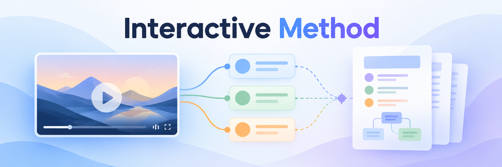

# Interactive Method

Paste a video link into a chat with the plugin enabled. The agent produces a first overview without asking you to select a skill or an analysis depth.

## The first result

The agent reads the transcript, examines targeted screenshots and returns a concise summary, the methods actually demonstrated, relevant timestamps and a neutral Mermaid diagram. Captures are part of this first pass, not deferred until a later request.

If no method can be identified, the overview says so and summarizes the video's content without inventing a procedure. Missing or inaccessible evidence is reported as uncertainty, not proof that there is no method.

Only after presenting this result does the agent ask whether you want to go deeper.

## Going deeper

If you ask to continue, the agent divides the methods into bounded assignments, delegates them when the host supports agents, and consolidates the transcript with the captures. It produces an editable Markdown playbook and a VuePress site, then opens the site in the host's browser.

VuePress builds the Markdown into a site with section navigation, code, tables and screenshots. The official `@vuepress/plugin-markdown-chart` plugin renders Mermaid blocks with the neutral theme. The agent runs the build and opens the local preview; the person supplying the video does not run framework commands. VuePress is a static site generator, so it needs a build step rather than a browser-only CDN script.

The first build needs npm and a network connection to install the pinned toolchain in the operating system's user cache. Later builds reuse it. The finished site contains its own assets and can be read offline through the local HTTP server. Keep the entire site directory when moving it; the HTML launcher alone is not the document.

Supplementary external sources require a separate explicit request. Agreeing to deepen the video's analysis does not authorize outside research.

## Automatic invocation

The plugin exposes one agent entry point, `guide-session`, with implicit invocation enabled. The remaining workflows are internal references used by the agent. There is no user-facing skill sequence to run.

The host selects skills based on the prompt and loaded plugin metadata. Open a new chat after installing an update so it can load the current instructions. The plugin does not register a global URL hook or change the host's permissions.

## Installation

Windows x64, Node.js >=22.19.0, npm and pnpm 10.22.0 are required. Clone the source project, generate a package, register the local marketplace and install it.

```powershell
git clone https://github.com/djdevpro/Interactive-Method.git
cd Interactive-Method
pnpm install --frozen-lockfile --ignore-scripts
pnpm setup:ffmpeg
pnpm package
codex plugin marketplace add ./releases/local-marketplace --json
codex plugin add video-method-lab@learning-coder-local --json
```

The Git repository contains the source. `pnpm package` generates `runtime/`, the installable archive and the local marketplace in `releases/`; these build outputs are intentionally untracked. Build the package before installing the plugin. The stable plugin ID `video-method-lab` preserves compatibility with existing installations and saved sessions.

For Claude Code, load the extracted plugin directory.

```powershell
claude --plugin-dir C:/plugins/video-method-lab
```

The host provides reasoning, image inspection, delegation and browser access. Where a capability is unavailable, the agent reports the limitation and retains a resumable workspace.

## Project contents

| Path | Purpose |
| --- | --- |
| `skills/guide-session/` | Automatic entry point and interaction policy |
| `references/` | Evidence contracts and internal agent workflows |
| `templates/` | Overview, method, session and playbook templates |
| `runtime/` | Video tools, VuePress build helper, FFmpeg and licenses |
| `scripts/session.mjs` | Session initialization, deepening and validation |
| `src/` | Development sources |

Save analyses outside this repository and the installed plugin cache. Keep `releases/` empty after delivery; regenerate it before another installation. Development dependencies can be removed after verification.

## Maintainer commands

```powershell
pnpm typecheck
pnpm build
pnpm test
pnpm validate
pnpm package
pnpm smoke:package
```

Agent-facing command contracts are in the [CLI reference](references/cli-contract.md) and [session reference](references/session-contract.md). These commands are implementation details, not steps the person supplying a video needs to run.

## Evidence and limitations

A captured image must be inspected before it supports a claim. A described method is not necessarily verified or executed. Keep author statements, visual observations and inferences distinct, and preserve unresolved questions.

Plugin instructions and templates are maintained in English. Generated documents follow the user's explicit preference or conversation language, including headings, captions, navigation and Mermaid labels. A French conversation produces French documents. The video's language does not override this choice. Original quotations, identifiers and proper names retain their source form.

See [NOTICE.md](NOTICE.md) for licenses.
